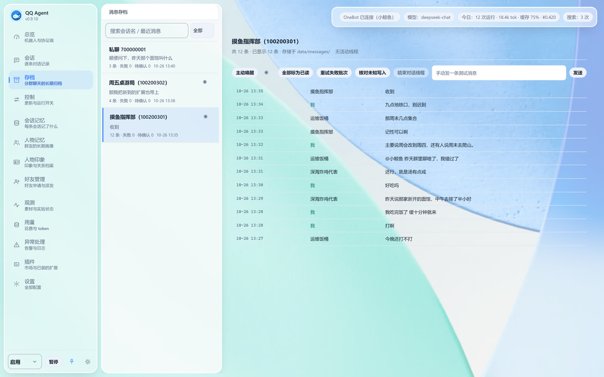
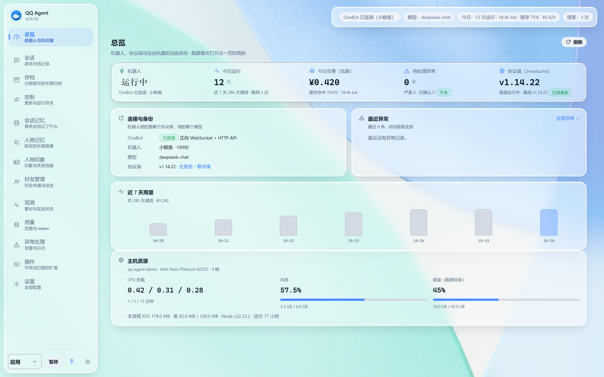
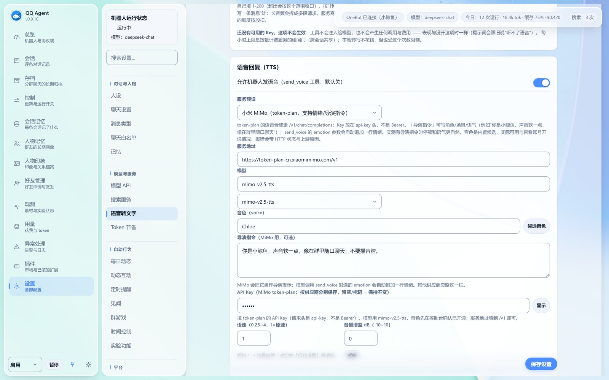
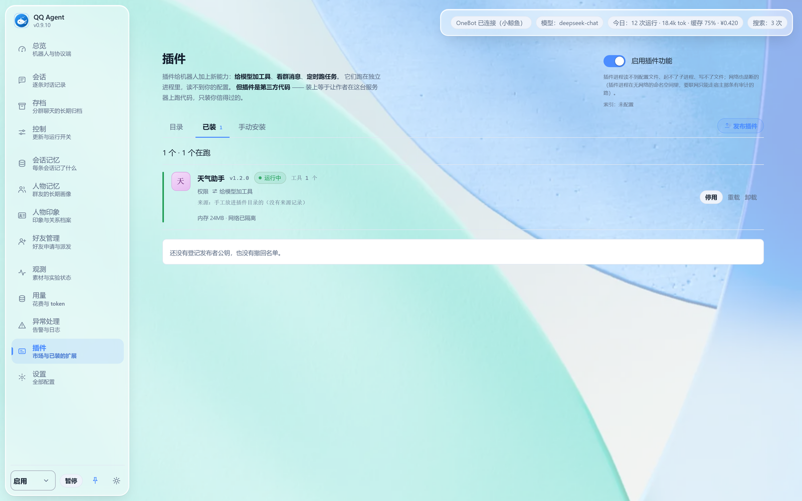

<div align="center">


# QQ Agent Plus

面向 Linux 服务器的 QQ 群聊 Agent，支持分条发言、表情包收发、长期记忆与内置运维命令。

[](https://github.com/sakurawwwxh/qq-agent-plus/actions/workflows/ci.yml)
[](LICENSE)
[](https://github.com/sakurawwwxh/qq-agent-plus/stargazers)
[](https://github.com/sakurawwwxh/qq-agent-plus/commits/main)
[](package.json)
[](docs/LINUX.md)
[](https://github.com/botuniverse/onebot-11)
[](#特性)

**简体中文** ｜ [English](README.en.md)



</div>

QQ Agent Plus 是面向 Linux 服务器的 QQ 群聊 Agent。它连接外部 OneBot v11 协议端，每次触发使用
独立的 OpenAI Chat Completions 会话，不依赖 DSH、MCP、Electron 或 Windows 运行环境。

## 特性

下列能力均来自实际群聊环境中的问题修复，每条对应的失败模式与处理方式记录在[改动清单](docs/CHANGES.md)。

- **对话行为**：单轮分条发言，先判断图片情绪再回应，表情包清单常驻系统提示（常用的 + 没用过的轮换，条数可调），结束前自检。
- **发送链路**：网络层发送重试，QQ 系统表情，消息 id 归一化，内联工具调用兜底解析。
- **网络抓取**：宿主侧抓取统一走 `safe-fetch`。HTTPS GET 与媒体下载优先 HTTP/2（ALPN），
  服务端不支持或连接层失败时自动回落 HTTP/1.1；DNS 固定、内网拦截、逐跳重定向校验、
  跨源凭据剥离、响应体/解压上限与超时都在。POST 仍走 HTTP/1.1，避免重复写入。
  Cloudflare 按 HTTP 版本挑战的站点（e926/e621 等）因此可以直接访问。
- **贴纸系统**：自动收藏并优先使用 QQ 收藏表情，查找兜底，同步护栏。
- **玩法与提醒**：轻量小游戏直接玩（成语接龙 / 猜数字 / 20 个问题 / 真心话大冒险；掷骰子、抽签、随机点名用 `dice` 与群成员名单）；**状态机主持的多人游戏**（数字炸弹、谁是卧底、狼人杀——轮次/计票/判定由系统负责，身份与夜间行动只走私聊，模型不会说漏嘴；实验特性、默认关，狼人杀还需在控制台白名单里勾选）；「X 点提醒我 Y」会落成**持久化提醒**（重启不丢），支持每天/每周/5 字段 cron 与 IANA 时区，可设免打扰窗口和抖动，离线错过的多次触发只补最近一次，到点被唤醒后用它自己的口吻说出来。
- **MCP 只读资源**：`node src/mcp/resource-server.js` 向任意 MCP 客户端暴露全局人物记忆、群梗库、待触发提醒三类资源；出口统一脱敏，不含会话记录、配置与凭据，也没有写路径。
- **主动发言**：三条链路各自可关（会话安静时发起话题 / 无人回应时补一句 / 模型自安排唤醒），多活跃时段；
  群聊与私聊各自独立计时、掷骰和记录判定，互不占用机会。间隔护栏、跳过原因日志，重启后补齐漏收消息。
- **生活层（见闻）**：可选从 B 站公开接口觅食，按人设兴趣与群聊话题筛选候选，由机器人主动挑内容分享；
  默认关闭，复用现有主动发言的安静时段、预算与发送队列。见[生活层文档](docs/LIFE-FEED.md)。
- **模型接入**：思考档位按渠道翻译、按供应商/按任务分设（设置 → 模型 API → 「高级：思考模式」），服务商审核拦截重试，兜底模型切换。
- **语音**（转写与回复）：语音/音频文件/视频音轨转成文字再交给聊天模型（与模型是否多模态无关）。
  **默认走 API Key 的托管服务**（预置硅基流动的地址：粘一个 Key、从官网拉一次模型列表就能用；
  也可一键换成 Groq / 火山 Seed-ASR / 阿里云百炼 / 讯飞 / 腾讯云 / 百度 / 自建，各家对新用户多有免费额度）；
  也支持**零 Key 的本机 whisper.cpp**（离线、免费，控制台里点一下就能装、也能完整卸载，或跑
  `node scripts/install-asr-local.mjs`）。QQ 语音（SILK）与视频音轨都能吃（SILK 本地解码，不需要协议端转码）；
  视频还能"看画面"：抽 4 帧拼成 2×2 帧条交给视觉模型（另有音轨转写），看到也能听到。
  反过来也能"说"：配好语音合成后它可以发语音回你（默认关，见配置示例）——支持 OpenAI 兼容（硅基流动/自建）、
  火山豆包大模型语音合成 2.0（音色最自然，只需一把控制台密钥）、火山 v1 与 MiniMax，控制台里有服务预设、
  模型与音色候选、可调语速与音量。语音的 Key 与搜索各自分开配。
  转写带每小时次数闸门（全局 + 每会话双闸）；群禁言时发送会直接报因、不再硬发。
- **图片生成**：群友说「画一张」时模型调 `generate_image` 出图，图**直接进表情库**再用现成的表情发送，
  不用另起一条链路（默认关，见配置示例）。控制台在「语音」页下方有「图片生成」区块与「试画一张」当场验证；
  预设里有一家**免 Key** 的（Pollinations）可直接试玩。按张计费，闸门是每小时张数上限。
  换地址后旧的 Key **不会**跟过去（与转写同一套 Key 归属守卫）。
- **插件**：给机器人加第三方能力（给模型加工具 / 看群消息 / 定时跑任务）。每个插件跑在**独立子进程**里，
  manifest 只能拿到声明过的能力，且每条能力都由宿主实现 —— 插件读不到你的配置文件，也绕不过发送队列的
  禁言预检与限频。apiVersion 2 起，插件可以用 manifest 声明**设置面板**（文本/数字/开关/下拉/凭据，控制台
  统一渲染，作者不写界面代码；凭据 AES-256-GCM 加密落盘、不回显）；会改变外部账号数据的写操作走
  **信任模型**：动作开关默认关、每次执行要管理员批准具体目标、当天有配额、同插件两次写至少隔 60 秒、
  失败与幂等跳过自动退还，全部写操作留审计。升级前先对比 manifest，权限面变化必须确认；授权绑定
  manifest 哈希，升级后按变化范围重置批准与开关。控制台「插件」页可一键安装（官方索引 13 个，全部零依赖，
  含 B 站插件：搜索/看懂视频/下载合流发群/互动，写操作需逐次批准），也支持本地包与自己挂的索引；
  **自己写一个**见[插件文档](docs/PLUGINS.md)（生成骨架 → 真机调试 → 打包自测，三条命令），
  上架到官方索引走[索引仓库](https://github.com/sakurawwwxh/qq-agent-plugins)的 PR 流程 —— 控制台
  「插件 → 发布插件」页把这两件事和命令都列在了一处。插件是第三方代码，装之前请在详情页看清它声明的权限。
- **技能包**：只读 Markdown 流程 + 工具白名单，不执行第三方代码。用户要求按流程总结/分析时，模型先
  `skill_list` 再 `skill_use`；本轮只能调用技能允许的工具。默认关闭，可按群启用，内置群聊总结、视频读懂、
  评论分析三个示例。
  「技能市场」可按官方索引预览并安装额外技能（逐文件 sha256 校验、可卸载），见[技能文档](docs/SKILLS.md)。
- **长期记忆与检索**：人物印象和会话交接之外，`memory_query` 支持关键词/短句检索（FTS5 + 中文二元组）；
  默认每人最多 50 条、手写条目不删、默认不按时间过期（可配 0–3650 天）。见[记忆文档](docs/MEMORY.md)。
- **运维与可观测性**：备份默认 AES-256-GCM 加密，支持 `restore` 与演练；消息接口改为游标分页，
  支持 JSONL/CSV 导出与 `ops prune`；`/api/metrics` 提供 JSON 与 Prometheus 文本，日志可切结构化 JSON。

配置项示例见[配置示例](docs/CONFIG-EXAMPLES.md)。运维命令统一收录在 [src/ops.js](src/ops.js)，
用法见[运维工具](docs/OPS.md)。本地回归测试位于 [test/local/](test/local/README.md)。
衍生关系与第三方版权说明见 [NOTICE](NOTICE.md)。

## 界面

以下截图使用当前默认的 light + liquid glass 主题和匿名演示数据，展示总览、消息存档、语音回复与插件页：

<p align="center">
  
  
</p>
<p align="center">
  
  
</p>

## 示例

运维命令随程序提供（`src/ops.js`），只读命令不修改业务数据。

```text
$ node src/ops.js audit
===== 1. 服务与定时器 =====
  [正常] qq-agent-linux.service  active
  [正常] qq-agent-linux-update.timer  enabled
===== 3. 源码语法（全部 js） =====
  [正常] 所有 js 文件语法通过
===== 4. 未定义调用扫描 =====
  [正常] 可疑未定义调用点: 0
===== 8. 运行态 =====
  [正常] OneBot: connected=true …
===== 自检结论 =====
  全部通过（0 项异常）
（节选：实际共 11 段，含配置 / 数据文件 / 价格缺口 / 最近日志 / 主机资源等）

$ node src/ops.js watch-send --minutes=5
基线：outbox 最新 rowid=17，待处理消息 0 条
      最近一条人类消息：今晚还打不打
SEND_OK：机器人通过工具层成功回话 ｜ group:123456789 ｜ run=3f2c… ｜ state=sent ｜ 打啊
      人类上一条：今晚还打不打
```

以下为群聊中一轮对话的示意样例，非真实聊天记录。接住对方的话之后，如有补充内容则以独立气泡发出，
合适场合直接使用表情：

```text
群友： 今晚还打不打
机器人：打啊
机器人：我吃完饭了 缓十分钟就来
机器人：[表情包：别墨迹]
```

## 架构

```text
OneBot WebSocket
  -> 按会话串行入库
  -> SQLite/WAL 消息状态机
  -> 默认随机 8-12 秒、最长 20 秒有界聚合
  -> legacy / threaded / lifecycle 路由
  -> 可选持久化线程与检查点
  -> 一次性 Agent 会话
  -> 会话绑定工具
  -> OneBot HTTP
```

宿主侧的外部抓取统一走 `src/llm/safe-fetch.js`：HTTPS GET 与媒体下载优先 HTTP/2，失败回落
HTTP/1.1；SSRF/DNS 固定、逐跳重定向、凭据剥离、响应体与超时都在这一层收口。

消息仅在处理成功后确认。模型调用失败或进程退出时，未发送批次保持待处理状态并自动重试；发送结果
无法确认时进入 `held`，必须人工核对，以避免重复发言。

## 部署

### Docker

不想安装 systemd、只想跑容器时：

```bash
# 海外 / GitHub 可达
docker pull ghcr.io/sakurawwwxh/qq-agent-plus:0.9.12
# 国内（阿里云 ACR，公开，amd64/arm64）
docker pull crpi-xejkraqtqkngfp11.cn-guangzhou.personal.cr.aliyuncs.com/wangxinhong/qq-agent-plus:0.9.12

git clone https://github.com/sakurawwwxh/qq-agent-plus.git
cd qq-agent-plus
docker compose up -d
```

`docker compose up -d` 的默认镜像已经按国内网络配置：Agent 走上面的 ACR，协议端走
`docker.m.daocloud.io` 镜像站。海外用户可在环境变量里换回 GHCR 与官方 Docker Hub 镜像。
全新 Docker 配置默认是 `active`，加入白名单后会直接回复；想先观察设
`QQ_AGENT_RUNTIME_MODE=observe`。

体积敏感的场景注意：镜像磁盘约 1.2GB、压缩下载约 310MB，主要是 ffmpeg 及其依赖；
项目只提供完整版，以保证语音、视频、GIF 与大图降采样和裸机一致。

控制台访问信息在容器的 `/data/console-access.txt` 里（首次启动生成）。
国内镜像、协议端镜像、从裸机迁移与容器模式限制见 [docs/DOCKER.md](docs/DOCKER.md)。

### 全栈部署

全新 Linux 机器推荐使用一键安装脚本 `install.sh`：全程零提问，自动安装 Docker（需 sudo）、
下载 SnowLuma、配置 OneBot、部署 QQ Agent，并生成和同步全部服务凭据；装完打印"接下来三步"
（带登录令牌的控制台链接、扫码登录入口、白名单），模型 Key 与群号在网页控制台里填即可。
SnowLuma 已包含 OneBot，无需另行安装 NapCat 或 Lagrange。

**root 可以直接执行**。安装器会把机器人降权到一个普通服务用户（默认 `qqagent`），
不会让机器人进程以 root 运行；如果是从普通用户 `sudo` 执行，则沿用该用户。root 只负责
装 Docker、把服务用户加入 `docker` 组、开启 linger 和准备目录。装完后 root 用
`sudo qq-agent-manage logs` 看日志，普通用户仍可直接用 `manage.sh`。

注意：服务用户会被加入 `docker` 组，这是控制台“更新协议端”的前提；`docker` 组在 Linux 上
等价于宿主 root（可挂载宿主文件系统）。这里降的是应用进程身份，不是完整沙箱。如果你不需要
控制台更新协议端，可以在部署后把该用户移出 `docker` 组并手工管理 SnowLuma。

开始前建议先确认机器规格：

| 项目 | 建议 |
| --- | --- |
| 系统 | Ubuntu 22.04/24.04、Debian 12、Rocky/Alma 9 等带 systemd 的 Linux |
| CPU | 2 核起；1 核会明显拖慢扫码登录和模型回复 |
| 内存 | 2GB 起；1GB 很容易在 SnowLuma/Chromium 启动时 OOM |
| 磁盘 | 10GB 空闲，本机盘；SQLite 不支持 NFS/SMB |
| 网络 | 能访问 GitHub；Docker 镜像有国内镜像站兜底 |
| 账号 | root 或带 sudo 的普通用户；一个 QQ 号 |
| 模型 | OpenAI Chat Completions 兼容的地址、Key、模型名（可装完再配） |

发行版支持分三档：

- **已实测**：Ubuntu 22.04/24.04（当前生产环境）。
- **预期可用**：Debian 12/13、Ubuntu 26.04、Rocky Linux 9、AlmaLinux 9、Fedora、CentOS Stream、RHEL、Oracle Linux、Amazon Linux、Arch/Manjaro、openSUSE Leap/Tumbleweed、SLES、openEuler、Anolis、麒麟/UOS（按 dnf/yum/zypper/pacman 尝试）。Debian 12 官方仓库只有 Compose v1，需先按 Docker 官方文档配置 apt 仓库才能拿到 Compose v2。
- **明确不支持**：Alpine（musl）、NixOS、Gentoo、Void、WSL1，以及没有 systemd 的容器环境。

安装前可以先跑只读体检，它会打印发行版、包管理器、systemd、libc 和结论：

```bash
sh scripts/check-platform.sh
```

```bash
git clone https://github.com/sakurawwwxh/qq-agent-plus.git
cd qq-agent-plus
sudo bash install.sh     # root 或 sudo 都可以；服务会自动降权到普通用户
# 如果当前就是普通用户：
bash install.sh
```

GitHub 克隆慢或不通时，改用 Release 页面下载的源码包（或可信镜像站），解压后进入目录再执行
上面的命令；`install.sh` 需要完整仓库，不能只下载一个脚本文件。

需要边装边选（部署目录/端口/凭据/模型）时用交互式安装器 `deploy-all.sh`——它与 `install.sh`
是同一个安装器，只是把问题问出来而不是走默认值：

```bash
bash deploy-all.sh
```

默认部署目录为 `/mnt/data/qq-agent`，默认对外端口如下：

- `3210`：QQ Agent 控制台；
- `5099`：SnowLuma WebUI；
- `6081`：QQ 登录使用的 noVNC。

OneBot HTTP `3000` 与 WebSocket `3001` 默认仅绑定 `127.0.0.1`，不暴露到局域网。安装器不要求填写
本机 IP，完成后自动检测并打印访问地址。生成的凭据保存于 `/mnt/data/qq-agent/deployment-access.txt`，
权限为 `0600`。脚本不修改 UFW、firewalld 或云安全组。

**端口建议**：`3210` 控制台只对你的 IP 或 VPN 放行；`5099` 协议端后台和 `6081` 扫码登录
建议不要直接开公网，用 SSH 隧道：

```bash
ssh -L 3210:127.0.0.1:3210 -L 5099:127.0.0.1:5099 -L 6081:127.0.0.1:6081 <用户>@<服务器>
# 然后打开 http://127.0.0.1:3210
```

如果你还没有模型 Key：先去一个 OpenAI Chat Completions 兼容的服务商申请，装完在控制台的
「设置 → 模型 API」里选预设、填 Key、点「测试连通性」即可；也可以先装、之后再配。

交互式安装会询问模型 Base URL、模型名、API Key 与 QQ 白名单（**Key 留空＝跳过**，之后在网页
控制台「设置 → 模型 API」里配——一键安装默认走的就是这条）。基础设施启动后，打开脚本输出的
noVNC 地址并扫码登录 QQ，返回终端按 Enter；脚本会校验 OneBot 登录状态并询问是否激活。确认旧机器人
已停止或已排除相同群聊后，也可手动执行：

```bash
/mnt/data/qq-agent/app/manage.sh activate --confirm-exclusive
```

无人值守安装：

```bash
bash deploy-all.sh --yes --root-dir /mnt/data/qq-agent \
  --agent-port 3210 --snowluma-port 5099 --novnc-port 6081 \
  --model-base-url https://api.deepseek.com \
  --model-api-key "$DEEPSEEK_API_KEY" --model deepseek-chat \
  --allow-groups 123456789
```

无人值守模式必须提供模型配置，或显式添加 `--skip-model-config` 并在部署后从控制台填写。白名单可为空，
但机器人在配置允许的会话之前不会响应任何消息。

仅允许对本脚本管理且配置一致的安装重跑。写入前会校验 Agent 配置与部署记录、systemd 服务目录、
SnowLuma 容器的 Compose 归属与数据卷、端口占用情况；发现非受管安装、残留的不完整状态或被后台修改
过的凭据时，脚本报错退出，不覆盖配置、不重启服务，`--yes` 与 `--rotate-credentials` 均无法绕过该保护。

只读检查（不创建目录、不下载依赖、不修改服务）：

```bash
bash deploy-all.sh --check-only --root-dir /mnt/data/qq-agent
```

旧 Bridge/SnowLuma 生产环境应使用 `deploy.sh` 更新 Agent，并保留实际数据目录、监听地址与 OneBot
配置；不得删除已有数据或伪造 `.env` 绕过检查。全栈检查还需要 `realpath` 与 `ss`（iproute2）；
已安装 Docker 但无法读取容器时，脚本安全退出。

受管安装重跑会保留 SnowLuma 数据、QQ 登录态与现有凭据。如需同步轮换 Agent、OneBot、SnowLuma WebUI
与 noVNC 凭据，添加 `--rotate-credentials`；启用 SnowLuma 2FA 后还需提供 `--snowluma-totp`。
完整参数见：

```bash
bash deploy-all.sh --help
```

### 仅部署 QQ Agent

已有可用 OneBot v11 协议端，或仅需安装、更新 Agent 时使用 `deploy.sh`。运行要求：

- Linux，且可用 systemd 用户服务；
- 以非 root 的普通用户执行（服务注册为该用户的 systemd 用户服务）；
- `curl`、`tar`、`sha256sum`、`rsync`、`xz`、`git`（缺少合格 Node.js 时自动安装已校验的 Node 22）；
- 已运行的 OneBot v11 HTTP 与正向 WebSocket 服务；
- 兼容 OpenAI Chat Completions 的模型服务。

面板环境（宝塔 / aaPanel）的部署差异见[宝塔面板部署](docs/BAOTA.md)：面板仅作为管理界面，进程仍由
systemd 用户服务托管，不应通过面板的 Node 项目或 PM2 启动。

```bash
git clone https://github.com/sakurawwwxh/qq-agent-plus.git
cd qq-agent-plus

bash deploy.sh \
  --install-dir /mnt/data/qq-agent/app \
  --data-dir /mnt/data/qq-agent/data \
  --host 127.0.0.1 \
  --port 3210
```

`deploy.sh` 不安装 SnowLuma，适合已有协议端或仅更新 Agent 的场景。脚本执行以下操作：

- 校验参数、源码与 Node.js 的 `node:sqlite` 能力；
- 安装生产依赖；
- 自动检测或安装 Node.js 22 运行时；
- 初始化独立数据目录与控制台 Token；
- 注册并启用 `qq-agent-linux.service`；
- 配置进程异常自动重启；
- 检查端口冲突与 systemd unit；
- 首次安装以 `observe` 模式启动，更新时保留既有运行模式；
- 更新前自动创建代码快照，失败时恢复旧代码、配置与服务；
- 排除 `.git`、`.dbg`、运行数据、凭据与本地调试记录。

查看全部参数：

```bash
bash deploy.sh --help
```

已配置外部备份流程时，可显式跳过代码快照：

```bash
bash deploy.sh --install-dir /mnt/data/qq-agent/app \
  --data-dir /mnt/data/qq-agent/data --host 127.0.0.1 --port 3210 \
  --no-backup
```

首次从旧 Bridge 迁移连接配置时，可附加：

```bash
  --import-bridge /path/to/old/config.json \
  --credential-file /path/to/credentials.env
```

该操作仅复制配置，不修改旧目录与旧数据。

更新已有安装：

```bash
git pull --ff-only
bash deploy.sh \
  --install-dir /mnt/data/qq-agent/app \
  --data-dir /mnt/data/qq-agent/data \
  --host 127.0.0.1 \
  --port 3210
```

更新不重置运行模式，其余配置也保持不变。`--install-dir` 与 `--data-dir` 必须与现有安装一致：
传错目录会在任何改动前直接拒绝（服务未停、代码未动），不会创建一个新的空数据目录；迁移数据目录
需要同时给 `--allow-path-change` 和 `QQ_AGENT_ALLOW_PATH_CHANGE=1`，旧数据不会自动复制。
`--host` 与 `--port` 可以省略——省略时脚本沿用
`config.json` 中记录的现值并打印一行提示；显式传入时必须与首次安装相同（例如全栈安装用的是
`0.0.0.0`），否则控制台会从外部失联。当前监听地址可从 `DATA_DIR/console-access.txt` 的 URL 行读到。

默认在 `DATA_DIR/deploy-backups/` 创建部署前代码快照；安装、配置、systemd 校验或健康检查任一环节
失败时，自动恢复旧代码、配置与服务。

部署脚本同时安装独立的 GitHub 更新 service/timer。自动更新默认关闭，可在「控制 -> 更新部署」配置
管理员后恢复。提示与部署均以**已发布的 Release** 为准（草稿、预发布与 `main` 上的日常提交不计入），
目标为该 tag 对应的提交：先执行单元测试，再复用 `deploy.sh` 部署；本地版本不低于最新 Release 时
判定为已是最新、不回退（没有部署基线的安装除外，它会直接安装最新 Release），版本号无法解析时
才比较提交方向，无法判定方向时不执行；失败时回滚、停止自动更新并私聊通知管理员。
详见[自动更新部署](docs/AUTO_UPDATE.md)。

## 运维

### 服务管理

以下命令在安装目录（`--install-dir`）中执行：

```bash
bash manage.sh status
bash manage.sh logs
bash manage.sh health
bash manage.sh token
bash manage.sh restart
bash manage.sh observe
bash manage.sh activate --confirm-exclusive
bash manage.sh update-status
bash manage.sh update-now --confirm
bash manage.sh backup /path/to/new-backup-dir
```

### 运维工具

`manage.sh` 之外的运维工具（只读体检、数据备份、发送与登录监控、进程看门狗、表情名导出、非交互
部署、SSH 隧道）统一由 `src/ops.js` 提供，仅使用 Node 内置模块：

安装器默认部署到 `/mnt/data/qq-agent`，而 `ops.js` 的旧默认是 `/data/qq-agent`。先导出根目录，
或者给命令显式传 `--dir` / `--data`，否则体检、备份和定时器会看错目录：

```bash
export QQ_AGENT_DIR=/mnt/data/qq-agent

node src/ops.js help                     # 全部子命令
node src/ops.js audit                    # 服务 + 代码 + 数据体检（只读）
node src/ops.js audit-host               # 主机体检（只读）
node src/ops.js scan                     # 未定义调用扫描
node src/ops.js backup --confirm         # 停/起服务 + 加密打包数据目录，只留最近 4 份
node src/ops.js restore --from ~/qq-agent/backups/qq-agent-data-XXXX.tar.gz.enc --dry-run
node src/ops.js prune --days=90 --dry-run # 只删已确认送达的消息，先预演
node src/ops.js install-timers --print   # 查看四个 systemd user 定时器（backup / process-guard / health / audit-prune）
node src/ops.js console --open           # 建 SSH 隧道并打开控制台
```

每个子命令均支持 `--help`。`/api/metrics` 需要控制台令牌（`manage.sh token`），支持 JSON 与
`?format=prometheus`；环境变量、常用示例与远程执行说明见[运维工具文档](docs/OPS.md)。

### OneBot 连接异常的排查

控制台「设置 → OneBot」会把失败原因直接写出来（端口没监听 / 令牌不一致 / 地址解析不了等，
附原始错误）；原始字段仍在 `/api/status` 的 `onebot.error`，执行一次体检同样可以看到：

```bash
node src/ops.js audit --dir=/mnt/data/qq-agent     # 查看 "OneBot: connected=false error=…" 一行
journalctl --user -u qq-agent-linux -n 80 | grep -i onebot
```

> `ops.js` 直连协议端时默认使用 `3390` 端口；未修改过端口（安装脚本默认 `3000`）时，需设置
> `QQ_AGENT_ONEBOT_HTTP_PORT=3000`，否则该行会误报不可达。

按 error 内容对应处理：

- `ECONNREFUSED`：协议端未在该端口监听。先确认容器状态：
  `docker ps -a | grep snowluma`、`docker logs --tail 50 qq-agent-snowluma`。
- `401` / `403`：令牌不一致。协议端 `onebot.json` 中的 `accessToken` 必须与控制台
  「设置 -> OneBot」的 WS 令牌一致（HTTP 令牌留空则沿用 WS）。
- `ENOTFOUND`：地址无法解析，WS 地址有误（默认 `ws://127.0.0.1:3001`）。
- `ETIMEDOUT`：无法连接到目标主机（地址或防火墙）。
- `404` / `Unexpected server response`：端口填写错误，对端不是 WebSocket 协议端
  （HTTP 端口 `3000` 不能作为 WS 使用）。

需要注意的三点：

- 修改地址或令牌后必须重启服务才生效：连接仅在服务启动时建立一次，在控制台保存配置不会触发重连，
  需执行 `bash manage.sh restart`。
- 协议端必须提供**正向 WebSocket 服务**：本项目仅作为正向 WS 客户端，不提供反向 WS 服务端。
- 状态圆点含义：绿色表示已连接；黄色表示曾连接后断开（服务按退避策略自动重连，无需重启）；
  灰色表示从未连接。

QQ 未登录不属于“未连接”：此时 WS 连接正常，只是无法获取登录信息，可用
`node src/ops.js watch-login` 观察登录状态。

### 控制台访问

控制台默认端口为 `3210`。仅部署 Agent（`deploy.sh`）时默认仅监听 `127.0.0.1`，本机通过 SSH 隧道
访问即可，无需开放任何公网端口；全栈安装器（`deploy-all.sh`）新装默认也把控制台、SnowLuma WebUI
（5099）与 noVNC（6081）绑在 `127.0.0.1`，远程访问走 SSH 隧道。只有显式传 `--publish` 才会绑
`0.0.0.0`，此时应仅向可信局域网或 VPN 放行，并自行收紧云安全组。存量安装不加参数时沿用现有绑定。
推荐从**你自己的电脑**建 SSH 隧道：

```bash
ssh -N -L 3210:127.0.0.1:3210 -L 5099:127.0.0.1:5099 -L 6081:127.0.0.1:6081 <用户>@<服务器>
```

本地不需要克隆仓库。也可以只下载一个连接脚本，它会自动从服务器读取令牌、建隧道并免登录打开浏览器：

- Windows：`scp <用户>@<服务器>:<安装根目录>/app/console-tunnel.bat .`，双击运行。
- macOS/Linux：`scp <用户>@<服务器>:<安装根目录>/app/console-tunnel.sh .`，然后 `bash console-tunnel.sh`。
- 已安装 Node：`node src/ops.js console --open`，效果相同。

两个脚本都会同时转发 `5099`（SnowLuma WebUI）与 `6081`（QQ 扫码登录），并读取服务器上的登录凭据。

Token 可在「设置 -> 系统 -> 控制台安全」中轮换。控制台一旦可被其他主机访问，令牌即为唯一凭据，只能自己使用。

顶层「控制」页是统一运维入口，提供 QQ Agent、DSH、Bridge、SnowLuma 与 QQ 远程桌面的入口与在线状态，
并可跳转到模型、搜索、OneBot 与控制台 Token 设置。该页支持手动更新、暂停或恢复自动更新；SnowLuma
登录密钥可在该页直接修改，密钥仅随单次请求发送，不写入 QQ Agent 配置或前端存储。旧 `3110` 门户不再映射。

启用前必须确认旧机器人未处理相同会话，否则会产生双回复。

## 数据与存储

数据默认位于部署参数指定的 `data` 目录：

- `config.json`：配置与凭据，权限 `0600`；
- `messages.sqlite`：消息、租约与出站状态；
- `sessions/`：每次 Agent 运行记录（默认保留最近 2000 份，且 90 天前的留档由每日保留期清理删除）；
- `memory/`：群友长期印象与跨 Session 会话交接状态；
- `identity-pilot.sqlite`：统一 QQ 身份索引与好友请求审批台账；
- `slang-pilot.sqlite`：黑话试点已退役，不会再创建；
- `daily-moments.json`：QQ 空间动态的来源、草稿、随机计划与发布结果；
- `qzone-interactions.json`：好友动态未读队列、评论回复与外部写入状态；
- `console-access.txt`：控制台地址与 Token，权限 `0600`。

聊天、密钥、Token 与运行数据均被 Git 忽略。

## 控制台功能

### 响应概率

「设置 -> 聊天设置」中的响应概率滑条决定机器人对普通消息的回话比例，滑条数值即概率。`0%` 仅回应
被 @、被点名或命中关键词的消息，`100%` 回应任何消息；被 @、被点名或命中关键词的批次一定回应，
不受概率影响。概率按批独立抽签，不累计配额，也不构成“每 100 条回应几条”的额度。可统一设置，
也可关闭统一开关后为每个群单独设置；未单独设置的群聊与所有私聊跟随统一滑条。旧版四段式档位
（0-10 仅艾特、10-20 加关键词、20-90 概率、90-100 全响应）在首次读盘时换算一次：0-20 变为 `0%`，
20-90 按比例线性映射，90 以上变为 `100%`。新语义中没有“仅回应 @、不回应关键词”的档位，
因此旧的 0-10 设置换算后也会回应关键词。

### 人设

「设置 -> 人设」里的人设卡库提供多张内置角色卡（默认小鲸鱼、损友、温柔陪聊、技术宅、猫娘），
点一张卡就把它的正文填进草稿，点击页尾常驻的“保存设置”后生效。正文按小节展示：招牌特征、
AI 味黑名单、示例（✓ 可用 / ✗ 禁用）各按自己的形状渲染，每节右上角可以单独“编辑 / 恢复本节”，
整篇改乱了还能“恢复整张卡”。交流策略可选“原版群友”“自然可靠”或“角色卡优先”
（角色卡优先只保留安全与工具/记忆机制，语气与节奏完全交给角色正文），角色正文与管理员附加规则
均可修改，也可以当前草稿为基础用“＋ 新建自定义卡”创建副本。角色卡正文的
单一来源是 [`roles/`](roles) 目录，一张卡对应一个 markdown 文件，说明见[内置角色卡](docs/PERSONAS.md)。

### 会话与生命周期

每次 Agent 运行均有独立审计记录。`lifecycle` 模式按 `threadId` 持久化 provider transcript（含工具轨迹
与供应商返回的 `reasoning_content`），并在下一批消息中按原顺序续接；结构化 handoff 作为生命周期滚动
后的压缩状态继续保留。控制台可检查注入历史、最新完整模型输入以及逐轮 Token 与缓存命中。生命周期
默认在上次请求输入达到 32000 Token 时换代；单次 Agent 运行累计预算为 160000 Token，追加工具轮会在
请求前预估预算并安全收尾。

### 等待与批次

「设置 -> 聊天设置」可分别配置未思考等待的最短值与最长值。每次自动唤醒在范围内重新随机，默认
`8000-12000ms`；连续消息仍由 `maxBatchWaitMs=20000` 限制从首条待处理消息起的最长聚合时间。生命周期
的等待批次会立即归入当前 `threadId`，控制台不会先显示独立窗口再合并；新 Session 也不会抢占正在
查看的详情。生命周期批次栏支持横向滚动，切换批次时保留详情与批次栏位置。

### 计价与用量

顶部状态与用量页均按每次模型调用返回的 `usage`、实际模型与调用时刻计价。“今日”以及按天统计固定
使用 `Asia/Shanghai` 自然日，不受服务器系统时区影响。

### Token 节省

「设置 -> Token 节省」提供一个一键收口的省法：**只给几个"可控项"夹上限，不改写你在各分区填的值**，
关掉立刻恢复原样。三档：关闭（默认）/ 省 / 很省；设置页会列出每一项的"你的设置 / 当前生效"对照。

| 项 | 省 | 很省 |
| --- | --- | --- |
| 被艾特 / 全响应读多少条已读 | ≤80 | ≤40 |
| 关键词 / 随机档读多少条 | ≤50 / ≤30 | ≤30 / ≤20 |
| 单次运行工具轮数 | ≤8 | ≤5 |
| 单次运行累计 Token | ≤8 万 | ≤5 万 |
| 会话交接注入（字符） | ≤2000 | ≤1200 |
| 全局印象注入（字符） | ≤3000 | ≤1500 |
| 提示词里的表情清单条数 | ≤5 | ≤3 |

口径与实测：每次模型调用的**固定底**（系统提示 + 二十多个工具定义，数量随开关增减）约 1.2 万-1.5 万 token，这部分靠设置
改不动；剩下能压的就是上表这些。线上一次 7 天实测的快照（867 次调用 / 1836 万 token）里输入占 98.8%，其中**没命中
缓存的输入**占花费的 76% —— 所以 Token 节省的重点是"少读历史、少跑轮次、少叫模型"，而不是压输出。
要更省还可以配合：把「聊天设置」的响应概率调低、关掉用不到的「搜索服务」与图片输入、
用「时间控制」只在低谷时段活动（峰谷价差可再省约三分之一）。改完在「用量」页按天对比即可。

### QQ 空间动态

「设置 → QQ 空间动态」可启用。**内容来源**三选一：人设自己的动态（默认，不收集群聊，素材来自角色卡
兴趣库与可选的公开资料搜索）、群聊见闻、人设为主（群素材至多点缀一句）。任务按上海时间运行，读取
长期记忆与会话交接；模型可以联网研究、查看近期群图或收藏图，最终自行决定发布或跳过。**默认只生成
草稿**，在控制台确认或编辑正文后才发布；编辑同样要过事实边界检查。人设来源会与最近已发动态做大段
查重，并拦下"我今天去了/吃了"这类没有现实素材的断言。发布通过 SnowLuma `send_qzone_msg` 完成，
按日期记录幂等状态，重启不会自动重复发布结果不明的说说。

想保持旧行为（从群聊取材并按时自动发布），把来源改成「群聊见闻」、发布方式改成「自动发布」即可。
动态使用专门的说说提示词，完整读取角色卡与管理员附加规则，不再附加普通群聊的工具流程。
提示词与设计说明见[动态提示词](docs/DAILY_MOMENTS.md)。“生成新草稿”不发布；检查正文后可点击
“发布这份草稿”，直接发送同一份内容，不再次消耗模型 Token。中断的生成可重新执行；非法模型参数会
触发纠错，纠错失败显示“生成失败”。“发布结果待核对”只能核对空间记录，不能盲目重发。

### 动态互动

「设置 -> 动态互动」可按可配置间隔阅览好友动态、决定点赞或评论，并检查自己动态及已评论动态中的
新回复。未阅览内容按最新优先统一提交给模型，超出模型上下文窗口的旧条目继续保持未读。首次启用
默认只建立基线，不突然互动历史内容。设计、状态与幂等规则见[动态互动](docs/QZONE_INTERACTIONS.md)。

### 主动唤醒

存档页的“主动唤醒”由管理员显式运行：有未读消息时直接处理当前批次（不看响应概率）；没有未读消息时
读取该模式配置的最近存档，由模型自行决定是否发言。该操作仍受运行模式、暂停、白名单、时间控制、
并发上限与 `held` 状态保护。

### 实验功能与固化入口

「设置 -> 实验功能」只管理实验能力的运行开关与固化状态，不承载业务数据或高级参数。固化后对应功能
会取得独立顶层入口；关闭运行开关不会撤销入口或删除历史数据。

「人物印象」页（固化前的实验名为"旧印象"）按 QQ 号聚合白名单会话中的身份、别名、消息统计、好友状态及已有会话印象，并开放受限的
`person_memory_lookup` 查询工具。「好友管理」页处理收到的好友请求：管理员审批同意后调用标准
`set_friend_add_request` 并自动加入私聊白名单。主动好友候选（机器人主动加好友）已于 2026-09-25
整体退役——协议被服务端统一拒绝、上游不暴露内核加好友能力，且连续实验触发过账号风控，退役原因与
边界见[已知问题](docs/KNOWN-ISSUES.md)；入站好友请求的审批不受影响。实现边界见
[已转正的稳定特性](docs/STABLE_FEATURES.md)。

「观测」页展示并管理表情包、黑话与黑话研究数据。人物与旧印象由固化后的独立页面管理，不再混放在
通用观测入口。手动上传的表情保存在数据目录；QQ 收藏表情的删除只会从 AI 资产库隐藏，不会改动 QQ
客户端收藏。表情图片通过控制台鉴权的同源代理加载，临时 QQ 图片 URL 不会返回给浏览器。详细口径见
[资产观测](docs/ASSET_OBSERVABILITY.md)。

自动黑话研究流水线**已退休**（`slangPilotEnabled()` 恒为 false，无法再启用）：提示词不再注入任何
黑话，历史配置中的开关不会再生效。见[已转正的稳定特性](docs/STABLE_FEATURES.md)。

## 时间控制

「设置 -> 时间控制」默认关闭。关闭时忽略全部时间规则，不改变现有唤醒、提示词、模型请求或消息处理
策略。开启后统一使用上海时间，全局规则默认为 DS 低峰：工作日 `00:00-09:00`、`12:00-14:00`、
`18:00-24:00`，周末全天。每个群聊及私聊均可覆盖为继承全局、DS 低峰、自定义星期与时段或全天活跃。
自定义允许跨午夜，例如周五 `22:00-02:00` 延续至周六凌晨；`00:00-24:00` 为全天，自定义空时间表
表示始终非活跃。

非活跃期消息与拍一拍仅归档，不触发 AI，不积压自动补回复；进入活跃期后新消息按原模式处理，已归档
消息仍可作为历史上下文。模型请求、工具轮、重试、记忆整理及发送均受时间门控。QQ 空间动态与控制台
模型测试遵循全局时间表，每日汇总还会排除当前非活跃的会话；被时间限制挡住的定时动态推迟至活跃窗口。
到点的持久化提醒与模型自安排的唤醒同样顺延至活跃窗口（不作废，静默多久都等）；观察模式下提醒保持顺延、
自安排唤醒作废并记日志。

规则修改即时生效。在途请求跨入非活跃期会被中止，后续请求与发信被拦截；供应商对已经收到的请求仍
可能计费，无法承诺撤销这部分 Token。发送结果不明确的 `held` 记录不会因时间切换而被丢弃或自动重发。

## 验证

```bash
npm ci --omit=dev --ignore-scripts
npm run test:unit     # 单元测试
npm run test:local    # 本地回归（自动使用临时数据目录，不接触生产数据）
node src/ops.js scan --strict
npm audit --omit=dev
bash -n deploy.sh && bash -n deploy-all.sh && bash -n manage.sh
```

CI（GitHub Actions）在 main 分支推送和所有 PR 上执行语法检查、未定义调用扫描（严格模式）、单元测试、本地回归，
以及提示词 / 渲染 / 滚动 / 用量端到端回归。
当前基线上仍有一批已确认、暂不修的问题；数量与状态以[已知问题](docs/KNOWN-ISSUES.md)为准，不要在这里写死条数。

详细说明见 [Linux 运维手册](docs/LINUX.md)，全部文档见[文档索引](docs/README.md)。试验性三模式对话
引擎见 [Conversation Modes](docs/CONVERSATION_MODES.md)；早期参与者续接方案见
[Threaded Conversation Pilot](docs/research/THREADED_PILOT.md)。

## 许可

本项目使用 MIT 许可（见 [LICENSE](LICENSE)）；衍生关系与第三方版权见 [NOTICE](NOTICE.md)。
OneBot 协议端是独立软件，遵循其自身许可。
